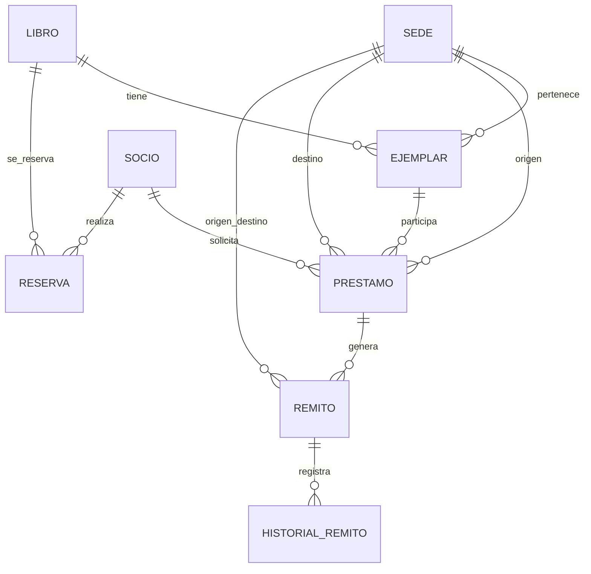
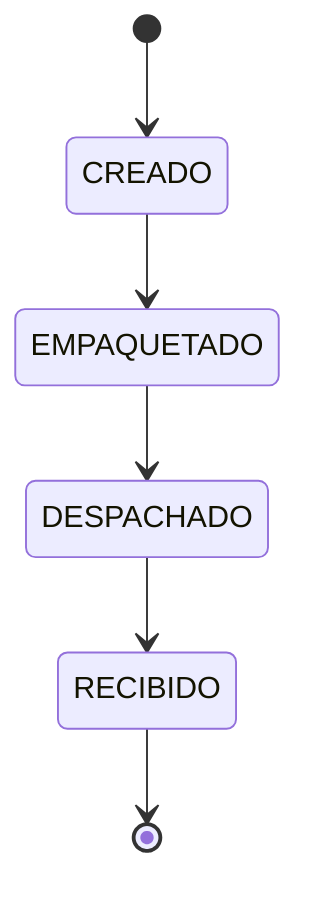

# Diseño y justificación del TPI

## Alcance y fuentes

Se implementaron los ocho procesos obligatorios y todas las validaciones indicadas en `Tema1 - Biblioteca.pdf`. Se siguieron los apuntes de la cátedra sobre clases, patrones de diseño, pruebas, SQLite y objetos de acceso a datos. No se asumieron requisitos de interfaz web ni de despliegue porque el enunciado no los establece.

## Modelo conceptual

- **Sede:** nombre único, dirección, contacto, horarios y estado activo/baja.
- **Socio:** documento único, nombre, correo y habilitación.
- **Libro:** ISBN único, título, autor y año. El ISBN identifica una ficha del catálogo, no un ejemplar físico.
- **Ejemplar:** código único, libro, sede de pertenencia, última sede física conocida y estado de disponibilidad.
- **Préstamo:** socio, ejemplar, origen, destino, tipo, estado, fechas, condición de devolución y multa. El tipo surge de comparar las sedes.
- **Remito:** identifica cada traslado de ida o regreso, con origen, destino, estado y fechas. Cada cambio produce un evento de historial.
- **Reserva:** pedido por socio, libro y sede de retiro. Su asignación es por orden de llegada.

Las claves foráneas, restricciones `UNIQUE`, `CHECK` e índices parciales de SQLite evitan duplicados y más de un préstamo vigente para el mismo ejemplar. Las operaciones que modifican varias tablas se ejecutan en una sola transacción.

## Ciclos de vida

El remito registra `CREADO` al generarse y cada transición con fecha y detalle. No se permite saltar ni repetir estados, ni registrar eventos anteriores al estado precedente. Antes de empaquetar o despachar, ambas sedes deben estar activas. La recepción puede completar un envío ya iniciado aunque una sede haya sido dada de baja después del despacho.

Un préstamo local pasa `SOLICITADO → ACTIVO → DEVUELTO`. Uno interbibliotecario pasa `SOLICITADO → EN_TRANSITO → LISTO → ACTIVO → DEVUELTO`. La entrega solo es posible después de la recepción en la sede de destino. Una devolución interbibliotecaria en buen estado o dañada genera un segundo remito de tipo `REGRESO`. El ejemplar no vuelve a estar disponible hasta recibir ese remito en la sede de origen. Una devolución dañada queda en revisión; el personal decide si vuelve a circulación o se da de baja. Un ejemplar destruido o extraviado se da de baja.

Estados del ejemplar: `DISPONIBLE`, `APARTADO`, `RESERVADO`, `PRESTADO`, `EN_TRANSITO`, `POR_RETORNAR`, `EN_REVISION`, `BAJA`. La sede actual representa la última ubicación física confirmada; mientras viaja, el remito indica su trayecto.

## Reglas de negocio y decisiones explícitas

| Regla | Aplicación |
|---|---|
| Ejemplar disponible | Solo se solicita si está `DISPONIBLE` o `RESERVADO` para el mismo socio. |
| Socio habilitado | Se verifica al reservar, solicitar y entregar. |
| Sedes activas | Se verifican al reservar, solicitar y comenzar o despachar remitos. |
| Propiedad del ejemplar | La sede de origen debe ser su sede de pertenencia y su ubicación actual. |
| Duplicados | Documento, ISBN, código de ejemplar y nombre de sede únicos. |
| Vencimiento | Catorce días corridos desde la entrega; no desde la solicitud. |
| Multa | $100 por día corrido de atraso. Se guarda en centavos enteros para evitar errores de redondeo. |
| Reservas | Cola por libro y sede; se asigna el primer ejemplar disponible a la primera reserva vigente de socio habilitado. Solo el titular puede solicitar ese ejemplar. |
| Condición de devolución | `BUENO`, `DANADO`, `DESTRUIDO` o `EXTRAVIADO`. |

El plazo y la multa son decisiones de diseño porque el enunciado pide control de vencimientos y reportes de multas, pero no indica valores. Están centralizados en `Biblioteca.PLAZO_DIAS` y `Biblioteca.MULTA_DIARIA_CENTAVOS` para facilitar su cambio. Las reservas se gestionan en la sede de retiro y se asignan a ejemplares físicamente disponibles en ella. Los materiales interbibliotecarios regresan siempre a su sede de pertenencia.

## Patrones de diseño aplicados

1. **Fábrica simple:** `FabricaPrestamos.crear` encapsula la elección entre `PrestamoLocal` y `PrestamoInterbibliotecario`. El caso de uso solicita un préstamo sin instanciar clases concretas. El tipo se persiste y determina si se necesita remito. No es el Factory Method formal con jerarquía de fábricas.
2. **Observer:** `Remito` notifica cada transición a `HistorialRemito`, que guarda el evento en `historial_remitos`. La transición y el evento se confirman en la misma transacción; si falla, ambos se revierten. Este desacoplamiento permite agregar otros observadores sin modificar el remito.
3. **State:** `Remito`, `Prestamo`, `Ejemplar` y `Reserva` reconstruyen su objeto de estado a partir del valor persistido y le delegan las transiciones. Los estados terminales rechazan avances y las demás clases aceptan solo los pasos del ciclo de vida definido.
4. **DAO:** cada agregado tiene su DAO (`SedeDAO`, `SocioDAO`, `LibroDAO`, `EjemplarDAO`, `ReservaDAO`, `PrestamoDAO` y `RemitoDAO`); `CatalogoDAO` y `ReportesDAO` resuelven consultas de lectura. `Biblioteca` coordina los casos de uso y todos los DAO comparten la conexión de la operación para mantener atomicidad. `BaseDatos` administra el esquema, el cierre y `commit`/`rollback`.

El [diagrama de clases](docs/DIAGRAMA_CLASES.md) es la referencia de la implementación actual, con una clase propia por archivo y la explicación del circuito de préstamos y remitos.

No se necesita Singleton para SQLite: cada operación usa una conexión corta y aislada. Tampoco hay construcción gradual que justifique Builder ni algoritmos alternativos reales para Strategy. El material de semana 10 presenta ambos patrones como opciones según el problema, no como obligación de implementarlos todos. La trazabilidad por PDF y página se detalla en `README.md`.

## Reportes implementados

| Nombre | Contenido |
|---|---|
| `activos_transito` | Préstamos activos, listos o en tránsito y remitos de regreso despachados, con libro, socio, ejemplar y sedes del trayecto. |
| `vencidos_multas` | Préstamos activos vencidos, días de atraso y multa estimada a la fecha de consulta. |
| `mas_solicitados` | Libros ordenados por solicitudes interbibliotecarias. |
| `disponibilidad` | Total, disponibles y en tránsito por libro y última sede conocida. |
| `logistica` | Remitos totales, recibidos, en tránsito, porcentaje recibido y tiempo medio desde creación a recepción. |
| `movimientos` | Cantidad y tiempo medio de traslados por par origen/destino y tipo ida/regreso. |

La tasa de recepción no es una tasa de entregas sin incidentes: solo expresa qué porcentaje de remitos creados ya llegó. El enunciado propone incidencias como reporte sugerido, pero el registro detallado de incidencias es un proceso opcional no implementado.

## Correspondencia con el enunciado

| Proceso obligatorio | Comandos / métodos |
|---|---|
| Sedes | `sede-crear`, `sede-editar`, `listar sedes` |
| Socios | `socio-crear`, `socio-editar`, `listar socios` |
| Catálogo y ejemplares | `libro-crear`, `libro-editar`, `ejemplar-crear`, `listar` |
| Solicitudes locales e interbibliotecarias | `prestamo-solicitar`, `prestamo-entregar` |
| Empaquetar, despachar y recibir | `remito-avanzar`, `remito-historial` |
| Disponibilidad | `disponibilidad`, reporte homónimo |
| Reservas | `reserva-crear`, `reserva-cancelar`, `listar reservas` |
| Devoluciones y condición física | `prestamo-devolver`, `revision-cerrar` |

Los procesos opcionales de notificaciones, historial de lecturas y recomendaciones no forman parte de esta entrega.
