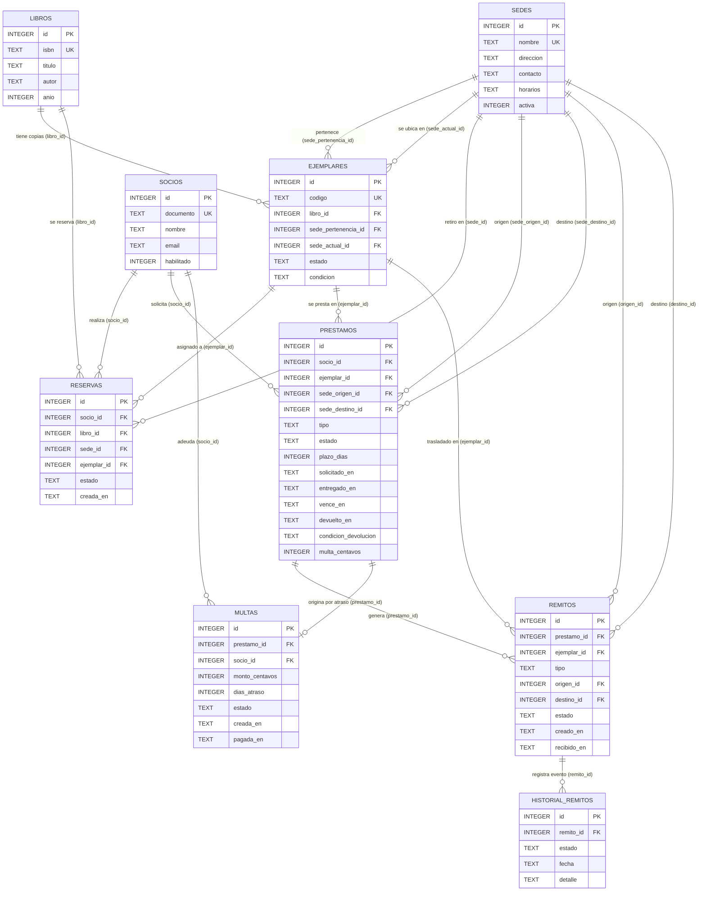
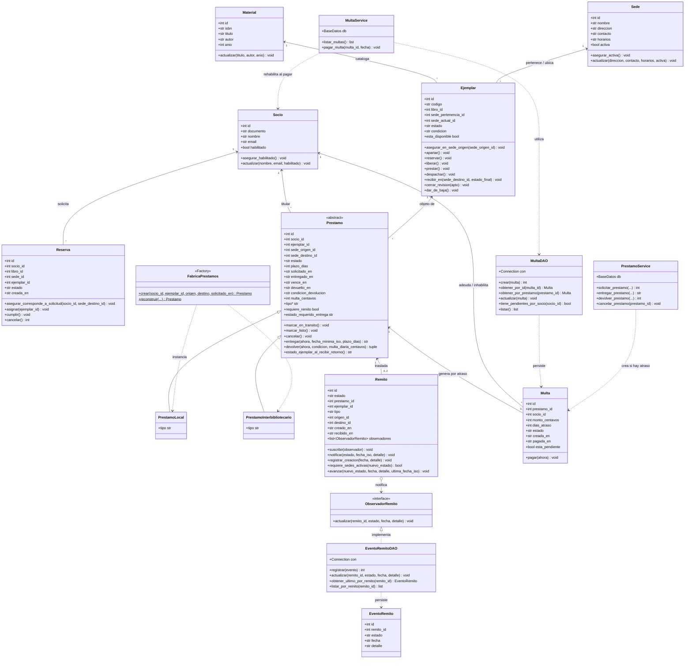
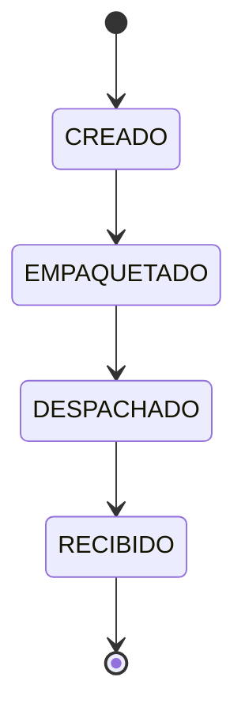

# Diseño y justificación del TPI

## Alcance y fuentes

Se implementaron los ocho procesos obligatorios y todas las validaciones indicadas en `Tema1 - Biblioteca.pdf`. Se siguieron los apuntes de la cátedra sobre arquitectura en capas, clases de dominio, patrones de diseño, pruebas, FastAPI, SQLite y objetos de acceso a datos (DAO).

## Arquitectura en capas

1. **Presentación (`frontend/`):** Aplicación web en **React** (`src/App.jsx`, `src/components/`, `src/views/`, `src/api.js` y `styles.css`) encargada de mostrar la información en componentes declarativos y permitir la interacción de los usuarios mediante llamadas REST.
2. **Controllers (`backend/controllers/`):** Implementados en archivos separados por recurso (`sede_controller.py`, `socio_controller.py`, `catalogo_controller.py`, `reserva_controller.py`, `prestamo_controller.py`, `remito_controller.py`, `multa_controller.py`, `reporte_controller.py`). Reciben solicitudes HTTP, validan la estructura con esquemas Pydantic (`schemas.py`), identifican al usuario y comprueban su autorización por rol (`dependencias.py`), e invocan los servicios correspondientes registrados en `backend/web.py`.
3. **Services (`backend/services/`):** Un archivo por servicio (`sede_service.py`, `socio_service.py`, `catalogo_service.py`, `reserva_service.py`, `prestamo_service.py`, `remito_service.py`, `multa_service.py`, `reporte_service.py`, `biblioteca_service.py`). Validan reglas del dominio, coordinan operaciones multi-DAO dentro de una misma transacción, utilizan entidades y patrones, y mantienen la coherencia entre solicitudes, préstamos, ejemplares, reservas, remitos y multas.
4. **Dominio / Models (`backend/models/`):** Un archivo por entidad (`sede.py`, `socio.py`, `material.py`, `ejemplar.py`, `reserva.py`, `prestamo.py`, `remito.py`, `multa.py`, `excepciones.py`) que encapsula datos, comportamientos propios y patrones (`FabricaPrestamos`, `ObservadorRemito`) sin código SQL ni dependencia de FastAPI.
5. **Persistencia / DAO (`backend/daos/`):** Un archivo por DAO (`sede_dao.py`, `socio_dao.py`, `material_dao.py`, `ejemplar_dao.py`, `solicitud_dao.py`, `prestamo_dao.py`, `reserva_dao.py`, `remito_dao.py`, `evento_remito_dao.py`, `multa_dao.py`), sin lógica de negocio ni decisiones de autorización.
6. **Base de datos (`backend/database/`):** Esquema relacional SQLite (`esquema.py`) y gestor transaccional de conexiones (`conexion.py`).

## Diagrama Entidad-Relación (DER) y Modelo de Datos

## Diagrama de Clases (Dominio, Patrones, Services y DAOs)

- **Sede:** nombre único, dirección, contacto, horarios y estado activo/baja.
- **Socio:** documento único, nombre, correo y habilitación.
- **Libro:** ISBN único, título, autor y año. El ISBN identifica una ficha del catálogo, no un ejemplar físico.
- **Ejemplar:** código único, libro, sede de pertenencia, última sede física conocida y estado de disponibilidad.
- **Préstamo:** socio, ejemplar, origen, destino, tipo, estado, fechas, condición de devolución y multa. El tipo surge de comparar las sedes.
- **Remito:** identifica cada traslado de ida o regreso, con origen, destino, estado y fechas. Cada cambio produce un evento de historial.
- **Reserva:** pedido por socio, libro y sede de retiro. Su asignación es por orden de llegada.
- **Multa:** registro persistente originado al devolver un préstamo con atraso. Conserva el monto en centavos, días de atraso y su estado (`PENDIENTE` o `PAGADA`). Mientras esté `PENDIENTE`, el socio permanece inhabilitado para nuevos préstamos o reservas hasta que se registre su pago.

Las claves foráneas, restricciones `UNIQUE`, `CHECK` e índices parciales de SQLite evitan duplicados y más de un préstamo vigente para el mismo ejemplar. Las operaciones que modifican varias tablas se ejecutan en una sola transacción.

## Ciclos de vida

El remito registra `CREADO` al generarse y cada transición con fecha y detalle. No se permite saltar ni repetir estados, ni registrar eventos anteriores al estado precedente. Antes de empaquetar o despachar, ambas sedes deben estar activas. La recepción puede completar un envío ya iniciado aunque una sede haya sido dada de baja después del despacho.

Un préstamo local pasa `SOLICITADO → ACTIVO → DEVUELTO`. Uno interbibliotecario pasa `SOLICITADO → EN_TRANSITO → LISTO → ACTIVO → DEVUELTO`. La entrega solo es posible después de la recepción en la sede de destino. Una devolución interbibliotecaria en buen estado o dañada genera un segundo remito de tipo `REGRESO`. El ejemplar no vuelve a estar disponible hasta recibir ese remito en la sede de origen. Una devolución dañada queda en revisión; el personal decide si vuelve a circulación o se da de baja. Un ejemplar destruido o extraviado se da de baja.

Estados del ejemplar: `DISPONIBLE`, `APARTADO`, `RESERVADO`, `PRESTADO`, `EN_TRANSITO`, `POR_RETORNAR`, `EN_REVISION`, `BAJA`. La sede actual representa la última ubicación física confirmada; mientras viaja, el remito indica su trayecto.

## Reglas de negocio y decisiones explícitas

| Regla | Aplicación |
|---|---|
| Ejemplar disponible | Solo se solicita si está `DISPONIBLE` o `RESERVADO` para el mismo socio. |
| Socio habilitado | Se verifica al reservar, solicitar y entregar. |
| Sedes activas | Se verifican al reservar, solicitar y comenzar o despachar remitos. |
| Propiedad del ejemplar | La sede de origen debe ser su sede de pertenencia y su ubicación actual. |
| Duplicados | Documento, ISBN, código de ejemplar y nombre de sede únicos. |
| Vencimiento | Plazo configurable al solicitar el préstamo (`plazo_dias`, por defecto 14 días corridos) calculado desde la entrega; no desde la solicitud. |
| Multa | $100 por día corrido de atraso. Al devolver con atraso se crea un registro en `multas` con estado `PENDIENTE` y el socio queda inhabilitado hasta que se registre el pago (`PAGADA`). |
| Reservas | Cola por libro y sede; se asigna el primer ejemplar disponible a la primera reserva vigente de socio habilitado. Si el socio solicita ese ejemplar u otra copia disponible del mismo libro en la sede de retiro, la reserva pasa a `CUMPLIDA` y cualquier copia previamente apartada se libera o reasigna. |
| Condición del ejemplar y devolución | `BUENO`, `DANADO`, `DESTRUIDO` o `EXTRAVIADO`, visible tanto en catálogo y selección de préstamo como al registrar la devolución. |
| Cancelaciones y bajas (`DELETE`) | Solicitudes en `SOLICITADO` pasan a `CANCELADO` liberando el ejemplar. Libros sin copias se eliminan físicamente. Ejemplares, sedes y socios sin historial se eliminan físicamente; si poseen historial, reciben baja lógica (`BAJA`, `activa = 0`, `habilitado = 0`) preservando los reportes. |

El plazo y la multa son decisiones de diseño porque el enunciado pide control de vencimientos y reportes de multas, pero no indica valores. Están centralizados en `Biblioteca.PLAZO_DIAS` y `Biblioteca.MULTA_DIARIA_CENTAVOS` para facilitar su cambio. Las reservas se gestionan en la sede de retiro y se asignan a ejemplares físicamente disponibles en ella. Los materiales interbibliotecarios regresan siempre a su sede de pertenencia.

## Patrones de diseño aplicados

1. **Factory / fábrica simple:** `FabricaPrestamos.crear` encapsula la elección entre `PrestamoLocal` y `PrestamoInterbibliotecario`. El caso de uso solicita un préstamo sin instanciar clases concretas. El tipo se persiste y determina si se necesita remito.
2. **Observer:** `Remito` notifica cada transición a `HistorialRemito`, que guarda el evento en `historial_remitos`. La transición y el evento se confirman en la misma transacción; si falla, ambos se revierten. Este desacoplamiento permite agregar otros observadores (por ejemplo, notificaciones) sin modificar el remito.

## Reportes implementados

| Nombre | Contenido |
|---|---|
| `activos_transito` | Préstamos activos, listos o en tránsito y remitos de regreso despachados, con libro, socio, ejemplar y sedes del trayecto. |
| `vencidos_multas` | Préstamos activos vencidos, días de atraso y multa estimada a la fecha de consulta. |
| `mas_solicitados` | Libros ordenados por solicitudes interbibliotecarias. |
| `disponibilidad` | Total, disponibles y en tránsito por libro y última sede conocida. |
| `logistica` | Remitos totales, recibidos, en tránsito, porcentaje recibido y tiempo medio desde creación a recepción. |
| `movimientos` | Cantidad y tiempo medio de traslados por par origen/destino y tipo ida/regreso. |

La tasa de recepción no es una tasa de entregas sin incidentes: solo expresa qué porcentaje de remitos creados ya llegó. El enunciado propone incidencias como reporte sugerido, pero el registro detallado de incidencias es un proceso opcional no implementado.

## Catálogo de Endpoints de la API REST

La comunicación entre la interfaz web (`frontend/`) y el backend (`backend/controllers/`) se efectúa mediante HTTP REST bajo la URI base relativa `/api/...` (por ejemplo `http://127.0.0.1:8000/api/...`). Todas las respuestas exitosas devuelven contenido en formato `application/json` (o HTML/CSS/JS para los recursos estáticos).

| Verbo | Endpoint | Parámetros (Path / Query / Body) | Respuesta JSON |
|---|---|---|---|
| `GET` | `/api/base` | Ninguno | `{"nombre": str, "demo": bool}` |
| `GET` | `/api/sedes` | Ninguno | `[{"id": int, "nombre": str, "direccion": str, "contacto": str, "horarios": str, "activa": int}, ...]` |
| `POST` | `/api/sedes` | **Body (JSON)**: `nombre` (str), `direccion` (str), `contacto` (str), `horarios` (str) | `{"id": int, "resultado": int}` *(HTTP 201)* |
| `PATCH` | `/api/sedes/{sede_id}` | **Path**: `sede_id` (int) **Body (JSON)**: `direccion?` (str), `contacto?` (str), `horarios?` (str), `activa?` (bool\|int) | `{"resultado": "ok"}` |
| `DELETE` | `/api/sedes/{sede_id}` | **Path**: `sede_id` (int) | `{"resultado": "eliminado" \| "baja_logica"}` |
| `GET` | `/api/socios` | Ninguno | `[{"id": int, "documento": str, "nombre": str, "email": str, "habilitado": int}, ...]` |
| `POST` | `/api/socios` | **Body (JSON)**: `documento` (str), `nombre` (str), `email` (str) | `{"id": int, "resultado": int}` *(HTTP 201)* |
| `PATCH` | `/api/socios/{socio_id}` | **Path**: `socio_id` (int) **Body (JSON)**: `nombre?` (str), `email?` (str), `habilitado?` (bool\|int) | `{"resultado": "ok"}` |
| `DELETE` | `/api/socios/{socio_id}` | **Path**: `socio_id` (int) | `{"resultado": "eliminado" \| "baja_logica"}` |
| `GET` | `/api/libros` *(alias: `/api/materiales`)* | Ninguno | `[{"id": int, "isbn": str, "titulo": str, "autor": str, "anio": int\|null}, ...]` |
| `POST` | `/api/libros` *(alias: `/api/materiales`)* | **Body (JSON)**: `isbn` (str), `titulo` (str), `autor` (str), `anio?` (int) | `{"id": int, "resultado": int}` *(HTTP 201)* |
| `PATCH` | `/api/libros/{libro_id}` *(alias: `/api/materiales/{libro_id}`)* | **Path**: `libro_id` (int) **Body (JSON)**: `titulo?` (str), `autor?` (str), `anio?` (int) | `{"resultado": "ok"}` |
| `DELETE` | `/api/libros/{libro_id}` *(alias: `/api/materiales/{libro_id}`)* | **Path**: `libro_id` (int) | `{"resultado": "eliminado"}` *(solo si no tiene ejemplares ni reservas)* |
| `GET` | `/api/ejemplares` | Ninguno | `[{"id": int, "codigo": str, "libro_id": int, "sede_pertenencia_id": int, "sede_actual_id": int, "estado": str, "condicion": str}, ...]` |
| `POST` | `/api/ejemplares` | **Body (JSON)**: `codigo` (str), `libro_id` (int), `sede_id` (int), `condicion?` (str) | `{"id": int, "resultado": int}` *(HTTP 201)* |
| `POST` | `/api/ejemplares/{ejemplar_id}/revision` | **Path**: `ejemplar_id` (int) **Body (JSON)**: `apto` (bool) | `{"resultado": "ok"}` |
| `DELETE` | `/api/ejemplares/{ejemplar_id}` | **Path**: `ejemplar_id` (int) | `{"resultado": "eliminado" \| "baja_logica"}` |
| `GET` | `/api/disponibilidad` | **Query**: `sede_id?` (int) | `[{"sede_id": int, "sede": str, "libro_id": int, "isbn": str, "titulo": str, "ejemplares_totales": int, "disponibles": int}, ...]` |
| `GET` | `/api/reservas` | Ninguno | `[{"id": int, "socio_id": int, "libro_id": int, "sede_id": int, "ejemplar_id": int\|null, "estado": str, "creada_en": str}, ...]` |
| `POST` | `/api/reservas` | **Body (JSON)**: `socio_id` (int), `libro_id` (int), `sede_id` (int) | `{"id": int, "resultado": int}` *(HTTP 201)* |
| `POST` | `/api/reservas/{reserva_id}/cancelar` *(alias: `DELETE /api/reservas/{reserva_id}`)* | **Path**: `reserva_id` (int) | `{"resultado": "ok"}` |
| `GET` | `/api/solicitudes` | Ninguno | `[{"id": int, "socio_id": int, "ejemplar_id": int, "sede_origen_id": int, "sede_destino_id": int, "tipo": str, "estado": str, ...}, ...]` |
| `GET` | `/api/prestamos` | Ninguno | `[{"id": int, "socio_id": int, "ejemplar_id": int, "sede_origen_id": int, "sede_destino_id": int, "tipo": str, "estado": str, "plazo_dias": int, "solicitado_en": str, "entregado_en": str\|null, "vence_en": str\|null, "devuelto_en": str\|null, "condicion_devolucion": str\|null, "multa_centavos": int}, ...]` |
| `POST` | `/api/solicitudes` *(alias: `/api/prestamos`)* | **Body (JSON)**: `socio_id` (int), `ejemplar_id` (int), `sede_origen_id` (int), `sede_destino_id` (int), `plazo_dias?` (int) | `{"id": int, "resultado": int}` *(HTTP 201)* |
| `POST` | `/api/prestamos/{prestamo_id}/entregar` | **Path**: `prestamo_id` (int) | `{"vence_en": str, "resultado": {"vence_en": str}}` |
| `POST` | `/api/prestamos/{prestamo_id}/devolver` | **Path**: `prestamo_id` (int) **Body (JSON)**: `condicion?` (str) | `{"multa_centavos": int, "resultado": {"multa_centavos": int}}` |
| `DELETE` | `/api/prestamos/{prestamo_id}` *(alias: `DELETE /api/solicitudes/{prestamo_id}`, `POST /api/prestamos/{prestamo_id}/cancelar`)* | **Path**: `prestamo_id` (int) | `{"resultado": "ok"}` *(cancela solicitud en estado `SOLICITADO` y libera el ejemplar)* |
| `GET` | `/api/remitos` | Ninguno | `[{"id": int, "prestamo_id": int, "ejemplar_id": int, "tipo": str, "origen_id": int, "destino_id": int, "estado": str, "creado_en": str, "recibido_en": str\|null}, ...]` |
| `POST` | `/api/remitos/{remito_id}/avanzar` | **Path**: `remito_id` (int) **Body (JSON)**: `estado` (str), `detalle?` (str) | `{"resultado": "ok"}` |
| `GET` | `/api/remitos/{remito_id}/historial` | **Path**: `remito_id` (int) | `[{"id": int, "remito_id": int, "estado": str, "fecha": str, "detalle": str}, ...]` |
| `GET` | `/api/multas` | Ninguno | `[{"id": int, "prestamo_id": int, "socio_id": int, "monto_centavos": int, "dias_atraso": int, "estado": str, "creada_en": str, "pagada_en": str\|null, "socio_nombre": str, "socio_documento": str, "ejemplar_id": int, "ejemplar_codigo": str, "libro_titulo": str}, ...]` |
| `POST` | `/api/multas/{multa_id}/pagar` | **Path**: `multa_id` (int) | `{"resultado": "ok"}` |
| `GET` | `/api/reportes` | Ninguno | `{"activos_transito": [...], "vencidos_multas": [...], "mas_solicitados": [...], "disponibilidad": [...], "logistica": [...], "movimientos": [...]}` |
| `GET` | `/api/reportes/{nombre}` | **Path**: `nombre` (str) | `[{"...": "..."}, ...]` *(registros del reporte solicitado)* |

## Correspondencia con el enunciado

| Proceso obligatorio | Comandos / métodos |
|---|---|
| Sedes | `sede-crear`, `sede-editar`, `listar sedes` |
| Socios | `socio-crear`, `socio-editar`, `listar socios` |
| Catálogo y ejemplares | `libro-crear`, `libro-editar`, `ejemplar-crear`, `listar` |
| Solicitudes locales e interbibliotecarias | `prestamo-solicitar`, `prestamo-entregar` |
| Empaquetar, despachar y recibir | `remito-avanzar`, `remito-historial` |
| Disponibilidad | `disponibilidad`, reporte homónimo |
| Reservas | `reserva-crear`, `reserva-cancelar`, `listar reservas` |
| Devoluciones y condición física | `prestamo-devolver`, `revision-cerrar` |

Los procesos opcionales de notificaciones, historial de lecturas y recomendaciones no forman parte de esta entrega.
