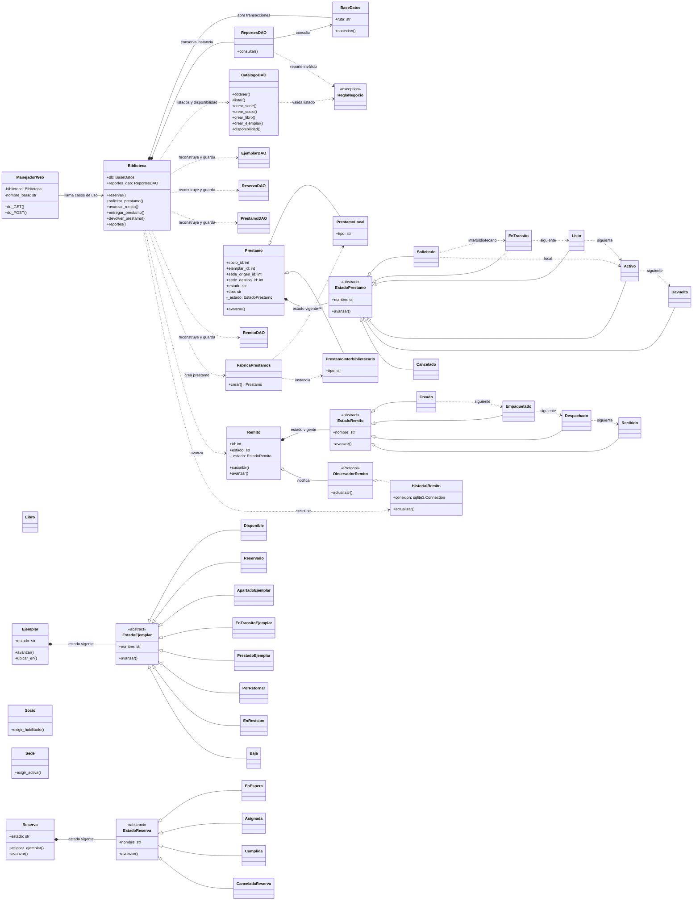

# Diagrama de clases de la biblioteca

Este diagrama representa **las clases Python que existen en el código**. Las entidades se reconstruyen desde SQLite mediante sus DAO: una fila persistida no se entrega directamente a la lógica de negocio.

## Cómo leer el circuito principal

1. La consola (`biblioteca/__main__.py`) o `ManejadorWeb` pide una operación a `Biblioteca`.
2. `Biblioteca` abre una conexión mediante `BaseDatos`, verifica las reglas y llama al DAO correspondiente con **esa misma conexión**.
3. Al solicitar un préstamo, `FabricaPrestamos` crea `PrestamoLocal` o `PrestamoInterbibliotecario`. Ambos reconstruyen su `EstadoPrestamo` desde SQLite; `Ejemplar` avanza a `APARTADO` y el segundo genera un remito de ida.
4. Al avanzar un remito, `Remito` delega la transición a su `EstadoRemito` actual. Solo se admite `Creado → Empaquetado → Despachado → Recibido`; esos cambios hacen avanzar también el préstamo interbibliotecario de `SOLICITADO → EN_TRANSITO → LISTO`.
5. Al entregar o devolver, `Prestamo` delega en su `EstadoPrestamo`: un préstamo local sigue `SOLICITADO → ACTIVO → DEVUELTO`, y uno interbibliotecario sigue `SOLICITADO → EN_TRANSITO → LISTO → ACTIVO → DEVUELTO`. `Ejemplar` y `Reserva` también delegan en State sus cambios de ciclo de vida.
6. `Remito` notifica a `HistorialRemito`, que guarda el evento dentro de la misma transacción. Si falla cualquier paso, `BaseDatos` revierte la operación.

## Ubicación de las clases

| Capa | Archivos que contienen una clase cada uno |
|---|---|
| Dominio | `catalogo/` (`Libro`, `Ejemplar`, `estados_ejemplar/`), `personas/` (`Socio`, `Sede`), `reservas/` (`Reserva`, `estados_reserva/`), `prestamos/` y `remitos/` con sus carpetas de estados; `regla_negocio.py` |
| Aplicación | `aplicacion/biblioteca.py` (fachada y coordinación), `servicio_catalogo.py`, `servicio_personas.py` |
| Persistencia | Un DAO por agregado (`sede_dao.py`, `socio_dao.py`, `libro_dao.py`, `ejemplar_dao.py`, `reserva_dao.py`, `prestamo_dao.py`, `remito_dao.py`), más reportes, historial y transacciones |
| Presentación | `presentacion/manejador_web.py` |

Las rutas de la tabla son relativas al paquete `biblioteca/`. `config.py`, `persistencia/esquema.py`, `presentacion/web_actions.py`, `web.py`, `demo.py` y `__main__.py` contienen constantes o funciones, sin clases adicionales.

Al sumar o cambiar una clase, actualizar este diagrama y la tabla de archivos en el mismo cambio. Así las relaciones dibujadas siguen correspondiendo a los imports y llamadas reales.
